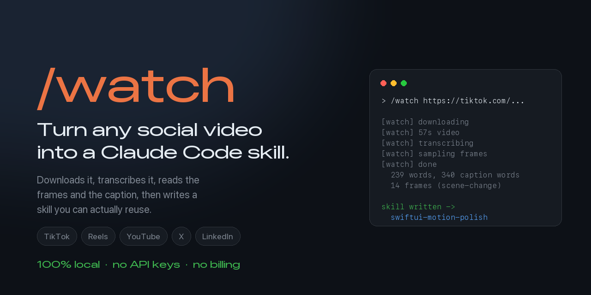
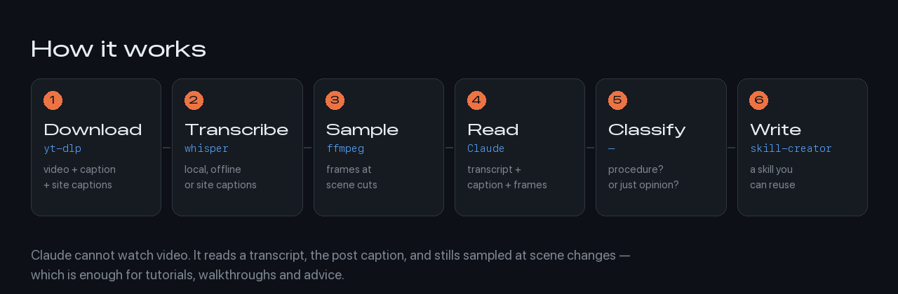
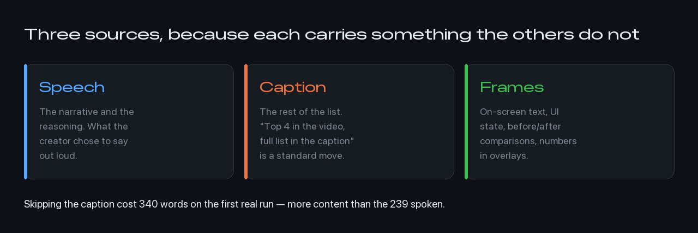

<div align="center">



**A [Claude Code](https://claude.com/claude-code) plugin that turns any social media video into a reusable skill.**

[](LICENSE)
[](https://docs.claude.com/en/docs/claude-code/plugins)
[](#why-it-costs-nothing)

</div>

---

You save a tutorial on TikTok. You watch it once. You never act on it.

`/watch` closes that loop. Paste a link, and Claude downloads the video,
transcribes it, reads the caption and the frames, works out whether it is
teaching an actual procedure, and writes it up as a skill it can use later.

```
/watch https://www.instagram.com/reel/Dd9unmGyVmp/
```

```
[watch] downloading
[watch] 57s video
[watch] transcribing with small.en
[watch] sampling frames
[watch] done -> /tmp/watch-reel
[watch] 239 words, 340 caption words, 14 frames (scene-change)

→ skill written: swiftui-motion-polish
```

## Install

```bash
# in Claude Code
/plugin marketplace add josephhamawi/claude-code-watch
/plugin install watch@josephhamawi
```

Then restart Claude Code, or run `/reload-plugins`.

<details>
<summary>Manual install</summary>

```bash
git clone https://github.com/josephhamawi/claude-code-watch.git \
  ~/.claude/skills/watch
```

Loads next session as `watch@skills-dir`.
</details>

### Requirements

| Tool | Install | Why |
|---|---|---|
| `yt-dlp` | `pipx install yt-dlp` | downloads the video and caption |
| `ffmpeg` | `brew install ffmpeg` | extracts audio and frames |
| `faster-whisper` | `pip install faster-whisper` | transcribes locally |

`faster-whisper` is only needed for videos that ship no captions. Most big
platforms provide them, in which case transcription is skipped entirely.

## How it works



Claude cannot watch video. It reads a transcript, the post caption, and
stills sampled at scene changes. That is enough for tutorials, walkthroughs
and advice — the content worth keeping. It is weak on fast motion and dense
screen recordings, where `--frames 30` helps.

## Why the caption matters



Most video tools transcribe the audio and stop. Creators plan around the
opposite: the video is the hook, the caption is the payload. "Those are my
top four, check the caption for the rest" is a standard structure.

On the first real run, the caption held **340 words to the video's 239** —
and five techniques that were never spoken aloud, plus a correction to one
that was.

## It does not make a skill out of everything

A skill built from a hot take is worse than no skill: it fires on unrelated
work and injects noise. So the video gets classified first.

| Kind | What happens |
|---|---|
| Repeatable procedure | Converted to a skill |
| A single tactic | Summarised; offered as a memory instead |
| Opinion, commentary, news | Summarised only |
| Product demo or ad | Summarised, claims flagged |
| Entertainment | Described |

Claims are marked as the creator's judgement rather than established
practice, and the source URL is recorded in every generated skill. Growth
and marketing videos are full of confident numbers with no evidence behind
them; those do not get laundered into instructions.

## Usage

```bash
/watch <url>                              # download, read, decide
/watch <url> make this a skill for X      # steer the conversion
/watch <url> just summarise it            # skip the skill
```

Under the hood you can also run the ingest step directly:

```bash
python3 ~/.claude/skills/watch/scripts/ingest.py "<url>" --out /tmp/pack
```

| Flag | Default | When to change it |
|---|---|---|
| `--frames N` | 12 | 30 for screen recordings, 6 for a static talking head |
| `--model` | `small.en` | `medium.en` for accents or jargon, `base.en` to go faster |
| `--local` | off | the argument is a file on disk, not a URL |
| `--out DIR` | `./watch-out` | where the pack is written |

The pack is plain files — `transcript.txt`, `caption.txt`, `frames/`,
`meta.json` — so it is useful on its own even without the skill step.

## Example

A real run on a 57-second Instagram reel about SwiftUI animation produced
[two skills](docs/example-nessie.md): one for motion polish, one for app
icon design. Eleven distinct techniques, five of which existed only in the
caption, and one correction to a technique the video described incorrectly.

## Why it costs nothing

Every step runs on your machine. `yt-dlp` downloads, `ffmpeg` samples,
`faster-whisper` transcribes locally. No API keys, no account, no billing,
no rate limits. The only network traffic is fetching the video itself.

## Limitations

- **Not real video understanding.** Stills plus a transcript. Fast motion
  and rapid screen recordings lose information between frames.
- **Private and age-gated content** needs cookies:
  `yt-dlp --cookies-from-browser chrome`.
- **Transcription is the slow step** when a platform ships no captions —
  roughly real-time on CPU.
- **Stale `yt-dlp` causes most failures.** A 403 almost always means the
  binary is out of date, not that the site blocked you.

## License

MIT. See [LICENSE](LICENSE).

---

<div align="center">
<sub>Built by <a href="https://github.com/josephhamawi">Joseph Hamawi</a>.
If it saved you a rewatch, a star helps other people find it.</sub>
</div>
